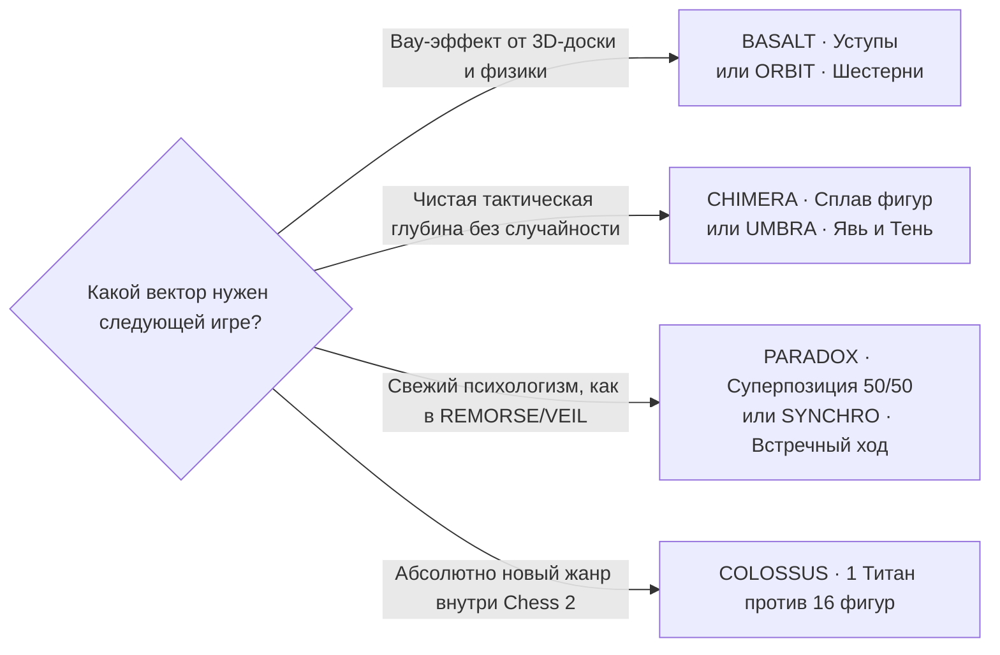

# Новые концепты игр для семейства Chess 2 (`chess-2.online`)

> **Статус:** креативный портфель концептов (только идеи, без кода, без утверждения реализации и без плейтестов).  
> **Контекст проекта:** на базе изученных материалов [CHESS_2_GAME_IDEAS.md](../CHESS_2_GAME_IDEAS.md), [DOMAINS_AND_GAME_CATALOG.md](../DOMAINS_AND_GAME_CATALOG.md), [ART_DIRECTION.md](../ART_DIRECTION.md), [RULES_DIGITAL_V1.md](../RULES_DIGITAL_V1.md), [ENGINE_AND_ARCHITECTURE.md](../ENGINE_AND_ARCHITECTURE.md), [ONLINE_ROOMS_V1.md](../ONLINE_ROOMS_V1.md), [TUTORIAL.md](../TUTORIAL.md) и [LOCALIZATION.md](../LOCALIZATION.md).

---

## 1. Зачем этот каталог и чем он отличается от уже существующих идей

В репозитории уже есть реализованный флагман **REMORSE** (`remorse.chess-2.online`), а также идеи из обсуждения 25 ноября 2026 года в [CHESS_2_GAME_IDEAS.md](../CHESS_2_GAME_IDEAS.md):

- **Пользовательские направления:** `OVERDRIVE` («Форсаж» — 2 ячейки энергии × 5 делений, усиленные приёмы), `WILDCARD` («Джокер» — колода карт способностей), `VEIL` («Завеса» — туман войны и разведка).
- **Предложенные ранее концепты:** `HOST` («Носитель»), `CHORUS` («Хор»), `LAST WILL` («Последняя воля»), `COUP` («Переворот»), а также ранние наброски `FRACTURE`, `REQUIEM`, `CITADEL`, `ECHO`.

Ниже — **семь принципиально новых, максимально смелых самостоятельных игр**, которые **не дублируют** ни одну из перечисленных механик. Каждая игра бьёт по отдельной «священной корове» классических шахмат: высоте поля, неподвижности сетки, однослойности пространства, определённости положения фигуры, постоянству класса фигуры, симметрии армий и поочерёдности ходов.

При проектировании учитывались правила и вкус проекта `iva-games`:
- **Мгновенный порог входа:** игрок, знающий как ходят шахматные фигуры, понимает главный трюк за 30 секунд.
- **Физическая 3D-выразительность + чистый 2D:** любая механика читается на самой мраморной доске и фигурах, без перегруза панелями, и должна помещаться в экран телефона `360×800` без скролла страницы.
- **Живучесть против затягивания и эксплойтов:** в каждой идее заранее заложены предохранители от вечных бункеров, бесконечных повторений и тупиковых ничьих.
- **Совместимость со стеком:** чистый core на TypeScript, реальный поиск для ИИ, полный RU/EN глоссарий и работа через серверные комнаты.

---

## 2. Семь новых игр: сводная карта

| # | Кодовое имя | Поддомен-кандидат | Какую аксиому шахмат ломает | Главный хук в одну строку | Рандом / Информация | ИИ / Вдвоём / Онлайн | Файл досье |
|---|---|---|---|---|---|---|---|
| 1 | **`BASALT`** / «Базальт» | `basalt.chess-2.online` | Плоская 2D-доска | Клетки — 3D-колонны разной высоты; фигуры карабкаются, сбрасывают уступы и проламывают стены. | Нет / Полная | Да / Да / Да | [01_BASALT.md](01_BASALT.md) |
| 2 | **`ORBIT`** / «Орбита» | `orbit.chess-2.online` | Неподвижные координаты | Внутри статичной рамки крутятся три каменных кольца, перестраивая линии и меняя цвет полей у слонов. | Нет / Полная | Да / Да / Да | [02_ORBIT.md](02_ORBIT.md) |
| 3 | **`UMBRA`** / «Изнанка» | `umbra.chess-2.online` | Единая плоскость бытия | Два слоя на одной доске (Явь и Тень): обходите стены «под землёй» и запирайте врага в тени сверху. | Нет / Полная | Да / Да / Да | [03_UMBRA.md](03_UMBRA.md) |
| 4 | **`PARADOX`** / «Парадокс» | `paradox.chess-2.online` | Фигура в одной клетке | Расщепляйте фигуры в квантовую суперпозицию 50/50 — реальность схлопывается только при столкновении. | 50/50 коллапс / Полная | Да / Да / Да | [04_PARADOX.md](04_PARADOX.md) |
| 5 | **`CHIMERA`** / «Химера» | `chimera.chess-2.online` | Фиксированный тип фигуры | Сливайте свои разные фигуры в гибриды (Ладья+Конь, Ферзь+Конь) и разделяйте их для двойного шаха. | Нет / Полная | Да / Да / Да | [05_CHIMERA.md](05_CHIMERA.md) |
| 6 | **`COLOSSUS`** / «Колосс» | `colossus.chess-2.online` | Симметрия 16 на 16 | Асимметричный босс-рейд: один 2×2 титан с бронеплитами против ордена из 16 обычных фигур. | Нет / Полная | Да / Да / Да | [06_COLOSSUS.md](06_COLOSSUS.md) |
| 7 | **`SYNCHRO`** / «Синхрон» | `synchro.chess-2.online` | Поочерёдные ходы | Оба игрока тайно выбирают ход и двигают фигуры одновременно: перехваты, промахи и столкновения по весу. | Нет / Скрытый ход | Да / Pass&Play* / Да | [07_SYNCHRO.md](07_SYNCHRO.md) |

*\* В `SYNCHRO` режим «Вдвоём» на одном устройстве требует передачи телефона с экраном скрытия хода (pass-and-play), тогда как игры #1–#6 работают на одном экране без скрытия.*

---

## 3. Матрица выбора: с чего начать, если хочется...

- **Максимальный визуальный шок в 3D (козырь стека Three.js / R3F):** `BASALT` (поднимающиеся и крошащиеся каменные колонны) и `ORBIT` (крутящаяся каменная астролябия с перетекающими слонами).
- **Самый чистый «взрыв мозга» без единого броска кубика:** `CHIMERA` (два правила: *Слияние* и *Высадка*) и `UMBRA` (две прозрачные плоскости на одной доске + тактика «похоронить фигуру в Изнанке»).
- **Лучшее продолжение линии `REMORSE` (напряжение + драматичный риск):** `PARADOX` (вместо травм от взятия — квантовый бросок в момент контакта с фантомом, причём без малейших шансов на дешёвый случайный удар по королю).
- **Лучшая игра для стримов, друзей и вирусного пересказа:** `COLOSSUS` (эмоции босс-файта на шахматной доске, где в реванше роли меняются местами) и `SYNCHRO` (взрыв эмоций от одновременного столкновения ферзей и перехвата пешкой на лету).

---

## 4. Общие ориентиры для всех семи концептов

1. **Единый дом:** все концепты задуманы как отдельные самостоятельные игры на своих поддоменах `*.chess-2.online`, связанные только общим эстетическим уровнем полированного физического набора, чистыми RU/EN терминами и архитектурой без скролла на мобильных.
2. **Честный статус:** ни одна из приведённых здесь механик ещё не проверялась полноценными пробными партиями. В каждом файле раздел **«Риски и открытые вопросы»** фиксирует конкретные узлы баланса, которые нужно проверить на бумаге или в маленьком прототипе до старта полноценной разработки.
